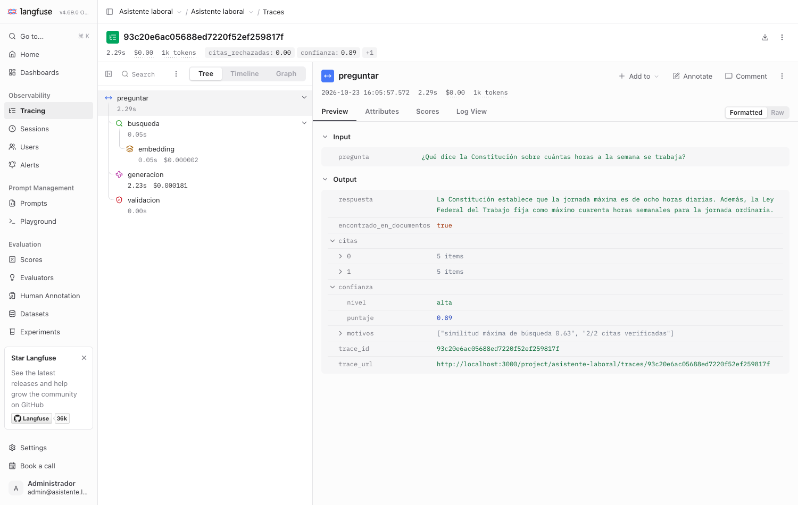
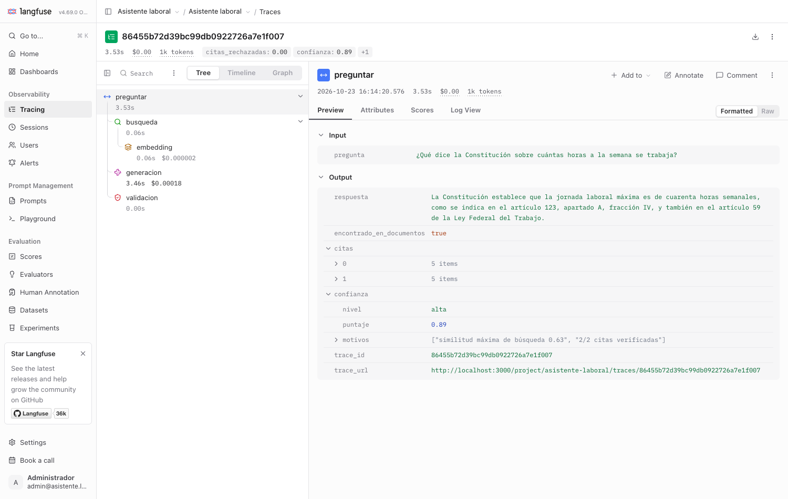

# Asistente de derechos laborales

Servicio que responde preguntas de empleados sobre sus derechos laborales usando la **Ley Federal del Trabajo** y el **artículo 123 constitucional**. Cada respuesta incluye:
- los artículos y fracciones que la respaldan, con el texto citado;
- un **nivel de confianza**;
- un aviso explícito cuando la respuesta no está en los documentos.

Todo corre **localmente con Ollama** y con modelos pequeños (≈4 GB de RAM al consultar).

| | |
|---|---|
| Documentos | LFT, **última reforma DOF 14-05-2026** · CPEUM (solo Art. 123), **última reforma DOF 07-10-2026**. Descargados de diputados.gob.mx el 23-oct-2026 (`data/fuentes/`) |
| Modelo | `qwen3:4b-instruct` (Ollama) · embeddings `bge-m3` · juez `qwen3:8b` |
| Stack | FastAPI · SQLite (FTS5 + embeddings en BLOB) · numpy · Langfuse · DeepEval · interfaz propia con HTMX (sin CDN: funciona sin internet) |
| Parte 2 | [`parte2_clasificacion/clasificacion_cancer_mama.ipynb`](parte2_clasificacion/clasificacion_cancer_mama.ipynb) |

---

## Cómo correrlo

Un solo punto de entrada, **`run.sh`** (macOS y Linux) o **`run.ps1`** (Windows). Detecta el sistema y muestra un menú:

```text
  Asistente de derechos laborales · sistema detectado: macOS arm64

    1) Instalar   Docker, Ollama y modelos
    2) Correr     levanta todo en Docker
    3) MAX        detiene lo demás y usa qwen3.8:27b-mlx
    4) Detener    para contenedores, modelos y Colima
    0) Salir
```

```bash
./run.sh            # menú: elige 1 la primera vez y 2 para correr
./run.sh 1 --con-juez   # sin menú; --con-juez descarga también el juez de la evaluación (~5 GB)
./run.sh 2              # sin menú (--sin-langfuse omite las trazas y ahorra ~2.5 GB de RAM)
./run.sh 3              # modo MAX (ver abajo)
./run.sh 4              # para todo
# Windows (PowerShell):  .\run.ps1   ·   .\run.ps1 1 -ConJuez   ·   .\run.ps1 2
```

| | **1) Instalar** | **2) Correr** |
|---|---|---|
| macOS | Colima + Docker CLI (Homebrew), Ollama y los modelos | Inicia Colima y Ollama si hacen falta, levanta la API en Docker y abre http://127.0.0.1:8000 |
| Linux / WSL2 | Docker Engine (script oficial, pide confirmación y sudo) | Ollama **en contenedor** (descarga los modelos la primera vez), API en Docker |
| Windows | Docker Desktop + Ollama con `winget` | Igual que macOS |

- En **macOS y Windows** Ollama corre en el host (usa la GPU) y el contenedor lo alcanza con `host.docker.internal`. En **Linux** corre en un contenedor, porque un Ollama que escucha solo en `127.0.0.1` (lo seguro) no es alcanzable desde un contenedor Linux.
- La primera vez, el servicio ingiere `data/fuentes/*.pdf` solo (~1 min); `run.sh` espera a que termine antes de abrir la interfaz.
- El puerto se publica únicamente en `127.0.0.1`.

En Windows (`run.ps1`) el menú tiene 1, 2 y 4; el modo MAX solo existe en macOS.

**Detener todo (`./run.sh 4`).** Baja los contenedores (tus datos siguen en los volúmenes de Docker), descarga los modelos de la memoria de Ollama, cierra los servidores locales de la API y apaga Colima para devolver la memoria de la máquina virtual. Ollama solo se cierra si lo inició `run.sh`; si ya estaba abierto (por ejemplo, su aplicación), se respeta. Para volver: `./run.sh 2`.

**Modo MAX (`./run.sh 3`).** Para cuando quieres la mejor respuesta y no te importa el consumo. Usa `qwen3.8:27b-mlx` (27.8 B de parámetros, cuantizado nvfp4, ~18 GB) en vez de `qwen3:4b-instruct`. Solo funciona en **macOS con Apple Silicon**, porque es un modelo MLX. Al activarlo, **detiene todo lo demás** para darle la máquina al modelo:
- los contenedores de Ollama (Linux) y cualquier evaluación en curso en un contenedor (pregunta antes);
- los servidores locales de la API fuera de Docker;
- los demás modelos cargados en Ollama (se conserva `bge-m3`, que la búsqueda necesita siempre).

Después precarga el modelo, lo mantiene en memoria una hora, sube el tiempo máximo por respuesta a 300 s y levanta la API con él (la barra lateral muestra una etiqueta **MAX**). **Langfuse sigue activo en modo max** (las trazas muestran las respuestas del modelo grande); `./run.sh 3 --sin-langfuse` lo apaga. Si falta el modelo, ofrece descargarlo. **Si hay una evaluación en curso, pregunta antes de detenerla** (una evaluación completa tarda ~1 h; sin terminal interactiva la respuesta es "no"). Para volver al modo normal, `./run.sh 2`, que además libera el modelo grande de la memoria.

**Evaluar el modo MAX (`./run.sh 3 --evaluar`).** Además de levantar el servicio, corre la evaluación completa de las 40 preguntas con el modelo grande y el mismo juez (`qwen3:8b`), y la guarda como una corrida aparte etiquetada `max` (`eval/reportes/eval_…_max.json`). **No reemplaza** el reporte principal ni toca tu calificación manual. En la pestaña Evaluación, la tabla *Corridas anteriores* lista ambas con su modelo y se puede abrir cualquiera. Esto cubre la comparación opcional del enunciado (*otro modelo*). Los resultados están más abajo, en "Comparación de modelos".

**Evaluación (un comando, proceso aparte):**

```bash
docker compose run --rm eval   # o: make eval (requiere ./run.sh 1 --con-juez; en Linux, PULL_JUDGE=1 ./run.sh 2)
make eval-rapida               # solo métricas deterministas (sin juez, ~3 min)
```

La evaluación ingiere los PDF por sí sola si la base está vacía.

**Otros comandos:** `make test` (32 pruebas, no requieren Ollama; necesita el entorno local de `uv`, que `run.sh 1` ofrece instalar) · `make seguridad` (bandit, ruff S, pip-audit) · `docker compose logs -f api` · `docker compose --profile ollama down` (detener).

Estado de las pruebas por plataforma: **macOS verificado** (Docker/Colima, menú, ingesta y preguntas en contenedor). La rama de **Linux** y `run.ps1` están escritos pero **no se han probado** en esos sistemas.

### Variables de entorno

Están documentadas en [`.env.example`](.env.example).
- El modelo y el juez son locales, así que **no necesitan llave**. `JUDGE_API_KEY` existe por si se cambia el juez a un proveedor externo.
- **Langfuse es local**: corre en Docker junto a la API y `run.sh` genera al azar sus llaves y secretos en `.env` (nunca están en el repositorio) y crea el proyecto con ellas, así que no hay nada que configurar a mano. Si se desactiva (`./run.sh 2 --sin-langfuse` o `LANGFUSE_ACTIVO=0`), el servicio funciona igual, solo que sin trazas.

---

## Interfaz web (un solo front end)

En http://127.0.0.1:8000 hay cuatro secciones, todas en la misma página y sin recargar:

| Sección | Qué muestra |
|---|---|
| **Asistente** | El chat. Cada respuesta trae las citas verificadas (con el texto oficial), la confianza y **el recorrido completo**: pasos ejecutados (búsqueda → generación → validación, más el reintento si hubo), una barra con el tiempo de cada uno, tokens, costo estimado, fragmentos recuperados con su similitud y posición en BM25/denso, términos que agregó el glosario, y las citas que la validación rechazó. Cuando no se llamó al modelo, el paso aparece como *omitido* y dice por qué. |
| **Evaluación** | Las métricas de DeepEval y las propias en tarjetas, el comportamiento por tipo de pregunta, la comparación entre corridas y la tabla de las 40 preguntas (con filtros). Al abrir una pregunta se ve la respuesta esperada contra la del asistente, los artículos esperados / recuperados / citados, y el desglose del juez con su razón. Ahí mismo se **califica a mano** y se compara contra el juez (ver abajo). |
| **Trazas** | Lo que registra Langfuse local, **sin salir de esta página**: la lista de preguntas (uso real o evaluación) y, al abrir una, la cascada de etapas (`preguntar` → `busqueda` → `embedding` → `generacion` → `validacion`) con su tiempo, tokens, costo y su entrada/salida. Langfuse no se puede incrustar (manda `X-Frame-Options: SAMEORIGIN`), así que el servidor lee su API con las llaves del proyecto, que nunca llegan al navegador. Cada respuesta del Asistente enlaza a su traza; hay también un enlace para abrirla en la interfaz de Langfuse (`localhost:3000`). |
| **Documentos** | Las leyes cargadas con su versión DOF, la subida de PDF y los trabajos de procesamiento con su resumen (artículos nuevos, modificados, eliminados y sin cambios). |

**Calificación manual contra el juez.** El enunciado pide calificar a mano al menos 15 respuestas. La calificación pertenece a **una** corrida (la principal): el CSV guarda las respuestas y los puntajes del juez de esa corrida, y si se calificara una respuesta de otra corrida se compararía contra el puntaje del juez equivocado. Por eso, al abrir otra corrida (por ejemplo la del modo max) la página deja verla pero no calificarla. En la pestaña Evaluación se califica cada una (¿correcta?, ¿fiel a los artículos?) y se guarda en `eval/calificacion_manual.csv`. Por defecto la tabla **oculta los puntajes del juez** ("calificar a ciegas") y el desglose del juez aparece colapsado: ver su puntaje antes sesga el criterio. Con las calificaciones, la página calcula el porcentaje de acuerdo y lista las discrepancias para explicarlas; es lo mismo que imprime `make comparar-juez`. Las razones del juez salen en inglés porque los *prompts* internos de DeepEval están en inglés.

La interfaz no carga nada de terceros: htmx 2.0.4 está incluido en `app/static/` y el CSS es propio, así que funciona sin internet y la política de seguridad (CSP) no permite scripts en línea ni externos.

## Ejemplos de las rutas

```bash
# Subir uno o varios PDF → responde de inmediato con el id del trabajo (202)
curl -F "archivos=@LFT.pdf" -F "archivos=@CPEUM.pdf" http://127.0.0.1:8000/documentos
# {"trabajo_id":"cc8cf816-…","estado":"pendiente","documentos":["LFT.pdf","CPEUM.pdf"]}

# Estado: pendiente | procesando | terminado | terminado_con_errores (con detalle por archivo)
curl http://127.0.0.1:8000/trabajo/cc8cf816-d8dc-48c2-8787-d0af8ad6f2dc

# Preguntar
curl -X POST http://127.0.0.1:8000/preguntar -H 'Content-Type: application/json' \
     -d '{"pregunta": "¿Me pueden correr por estar embarazada?"}'
```

Respuesta real del sistema (textos de las citas recortados aquí):

```json
{
  "respuesta": "No, no pueden correr usted por estar embarazada. La ley protege a las trabajadoras embarazadas de ser despedidas o coaccionadas a renunciar por este motivo.",
  "encontrado_en_documentos": true,
  "citas": [
    {"ley": "LFT", "articulo": "170", "apartado": null, "fraccion": "I",  "texto": "Las madres trabajadoras tendrán los siguientes derechos:\nI. Durante el período del embarazo…"},
    {"ley": "LFT", "articulo": "170", "apartado": null, "fraccion": "III", "texto": "Las madres trabajadoras tendrán los siguientes derechos:\nIII. Los períodos de descanso…"},
    {"ley": "LFT", "articulo": "133", "apartado": null, "fraccion": "XV", "texto": "Queda prohibido a las personas empleadoras o a sus representantes:\nXV. Despedir a una trabajadora o coaccionarla directa o indirectamente para que renuncie por estar embarazada…"},
    {"ley": "LFT", "articulo": "47",  "apartado": null, "fraccion": "XV", "texto": "Son causas de rescisión de la relación de trabajo, sin responsabilidad para el patrón:\nXV. Las análogas…"}
  ],
  "confianza": {"nivel": "alta", "puntaje": 0.78, "motivos": ["similitud máxima de búsqueda 0.56", "4/4 citas verificadas"]},
  "trace_id": "5815df97649fad92101d750282fe8d3c",
  "trace_url": "http://localhost:3000/project/asistente-laboral/traces/5815df…"
}
```

La cita clave es la del **Art. 133 fr. XV**. Este ejemplo muestra también el punto débil principal: el modelo **cita de más**. El Art. 47 XV es real y la validación lo acepta, pero no respalda la respuesta. Ver "Resultados" y "Qué haría distinto". El `trace_id`/`trace_url` solo aparecen con las llaves de Langfuse configuradas.

Cuando la respuesta no está en los documentos:

```json
{"respuesta": "No se especifica cuánto es el salario mínimo este año… la ley no da montos vigentes.",
 "encontrado_en_documentos": false, "citas": [],
 "confianza": {"nivel": "media", "puntaje": null, "motivos": ["el modelo indicó que los fragmentos no contienen la respuesta"]}}
```

Rutas adicionales: `GET /documentos` (leyes cargadas con su versión DOF) y `GET /salud`. Si se define `API_KEY`, todas las rutas exigen el encabezado `X-API-Key`.

---

## Arquitectura

```
POST /documentos ─► valida PDF (magic bytes, tamaño) ─► guarda con nombre UUID ─► cola ─► 202 {trabajo_id}
                                                                                    │
            worker (1 hilo): parsear ─► diff por artículo ─► embeddings (con caché) ─► SQLite ─► recargar índice

POST /preguntar ─► [busqueda] glosario + BM25 (FTS5) + embeddings (numpy) ─► RRF ─► top 6
                     │  similitud < 0.42 → "no está en los documentos" sin llamar al modelo
                     │  0.42–0.55 → el LLM reformula la pregunta en lenguaje legal y se busca otra vez
                   ─► [generacion] qwen3:4b-instruct con salida JSON forzada por esquema
                   ─► [validacion] cada cita: ¿existe? ¿estaba en los fragmentos? ¿el texto coincide?
                     │  si nada se sostiene → 1 reintento con el error; si sigue mal → abstención
                   ─► respuesta + citas con texto canónico + confianza          (traza Langfuse por etapa)
```

| Carpeta | Contenido |
|---|---|
| `app/ingesta/` | `parser_ley.py` (PDF → artículos → fragmentos), `ingesta.py` (diff por artículo), `worker.py` (cola de trabajos) |
| `app/busqueda/` | `texto.py` (stemming), `indice.py` (matriz en memoria), `hibrida.py` (BM25 + denso + RRF), `glosario.json` |
| `app/llm/` | `cliente.py` (Ollama), `prompts.py` (instrucciones y esquemas JSON) |
| `app/validacion/` | `citas.py` (verificación), `confianza.py` |
| `app/asistente.py` | orquesta el flujo y la traza de Langfuse |
| `eval/` | `preguntas.json` (40 preguntas), `correr_eval.py`, `juez.py`, `reportes/` |

---

## Cómo resolví cada reto

### 1. Documentos demasiado largos
**Fragmentación por estructura legal, no por tamaño fijo.**
- El parser reconoce los encabezados de artículo en todas sus variantes del PDF oficial: `1o.-`, `2º.-`, `15-A.`, `170 Bis.-`, `890-` y `123.` en la CPEUM.
- Une las líneas cortadas y quita los encabezados de página y las notas editoriales ("Párrafo reformado DOF…").
- **Los transitorios no se indexan**: repiten "Artículo 1º/2º…" en cada decreto y chocarían con la validación de citas.
- Un artículo de hasta 1800 caracteres es un fragmento. Uno más largo se divide **por fracción**, y cada fracción lleva el encabezado de su artículo o apartado como contexto. Así, "XV. Despedir a una trabajadora…" conserva "Queda prohibido a las personas empleadoras…".
- Resultado: 1262 artículos de la LFT + el Art. 123 → **2063 fragmentos**. Solo los 6 mejores (~1.4k tokens) van al modelo.

### 2. Los empleados no hablan como la ley
Usa tres capas, de la más barata a la más cara:
1. **Embeddings multilingües (`bge-m3`)**: "correr por embarazada" se parece semánticamente a "despedir a una trabajadora por estar embarazada".
2. **Glosario coloquial → legal** ([`glosario.json`](app/busqueda/glosario.json)). Por ejemplo, *correr* → despido, rescisión y *home office* → teletrabajo. Expande solo la consulta BM25. Es determinista, auditable y no usa el modelo.
3. **Reformulación con el LLM**, solo cuando la similitud queda en zona dudosa (0.42–0.55). Así no se paga una llamada extra en el caso común.

Ambas búsquedas se combinan con *Reciprocal Rank Fusion*, garantizando que los 2 mejores resultados por significado siempre entren (ver Reto 6).

### 3. Que no invente cuando no hay respuesta
- **Corto-circuito por similitud:** si el fragmento más parecido tiene similitud < 0.42, se responde "no está en los documentos" **sin llamar al modelo** (≈20 ms). El umbral se calibró con preguntas fuera de tema (≤0.40) contra preguntas laborales (≥0.56).
- **El modelo puede abstenerse:** el esquema de salida tiene `no_encontrado`, y el prompt pone de ejemplo los montos vigentes (salario mínimo, UMA), impuestos y trámites del IMSS.
- **Una respuesta sin al menos una cita verificada no se entrega como respuesta**: se convierte en abstención.
- Resultado en la evaluación: **6/6 preguntas sin respuesta se abstuvieron** (salario mínimo, ISR, IMSS, UMA, vales de despensa y una fuera de tema).

### 4. Validar la salida del modelo
1. **Salida estructurada:** Ollama restringe la generación a un JSON Schema y Pydantic la valida. El esquema limita longitudes (`maxLength`, `maxItems`) y `num_predict` acota tokens, porque un modelo pequeño puede repetir texto en bucle.
2. **Cada cita se verifica contra SQLite** ([`citas.py`](app/validacion/citas.py)):
   - el artículo **existe** para esa ley;
   - estaba **entre los fragmentos que se le dieron** (cita fuera de contexto = rechazada);
   - el texto que dice citar **coincide** con el real (fuzzy match ≥ 60 %).
3. **El texto que ve el usuario siempre es el canónico de la base**, nunca el que escribió el modelo.
4. Si la salida no es válida o ninguna cita se sostiene, hay **un reintento** con el error como retroalimentación. Si vuelve a fallar, el asistente se abstiene.

Casos reales atrapados:
- El modelo citó el **Art. 5** en una pregunta de aguinaldo, sin que estuviera en los fragmentos.
- Puso `"articulo": "F1"` porque confundió la etiqueta del fragmento con el número de artículo (ver caso de diagnóstico abajo).

### 5. Fallos aislados y actualización por reforma
- **Cada PDF de un trabajo se procesa en su propio `try`.** Un PDF corrupto queda en `error` con su mensaje, los demás terminan y el trabajo queda `terminado_con_errores`. Hay prueba automatizada.
- **Versionado por ley:** la ley se identifica por su título y la versión por "Última Reforma DOF". Luego:
  - PDF idéntico (mismo `sha256`) → `sin_cambios`, sin trabajo.
  - Reforma → **diff por artículo** (hash de cada uno). Solo se re-fragmentan y re-embeben los artículos **nuevos o modificados**; los derogados se eliminan de la base y del índice BM25.
  - **Caché de embeddings por hash de texto:** ningún texto igual se vuelve a embeber.
- Los trabajos que quedan a medias por un reinicio se re-encolan al arrancar.

### 6. ¿Falló la búsqueda, el modelo o la validación?
Cada `/preguntar` deja una traza con observaciones separadas:

| Observación | Qué registra |
|---|---|
| `busqueda` (retriever) + `embedding` | consulta, términos del glosario, reformulación, top-6 con similitud, rango BM25 y rango denso; tokens y costo del embedding |
| `generacion` (generation) | prompt completo, salida cruda, modelo, parámetros, **tokens de entrada/salida, costo**, `WARNING` si el JSON no validó |
| `validacion` (guardrail) | citas aceptadas y **rechazadas con el motivo** |
| *scores* de la traza | `confianza`, `encontrado_en_documentos`, `citas_rechazadas` (para filtrar respuestas malas) |

El **costo** es de referencia: el modelo local cuesta $0. Se calcula con un precio por millón de tokens configurable (`COSTO_*_USD_MTOK`) para simular un modelo hospedado comparable. Las trazas se quedan en tu máquina (Langfuse local). Aun así, los datos personales (correo, teléfono, CURP, RFC) se **enmascaran** antes de guardarse en ellas.

#### Caso real con su traza: "¿Qué dice la Constitución sobre cuántas horas a la semana se trabaja?"

**Traza del caso (Langfuse local, antes de corregir):**



- **Síntoma.** La respuesta fue: *"La Constitución establece que la jornada máxima es de ocho horas diarias. Además, la Ley Federal del Trabajo fija como máximo cuarenta horas semanales"*. Todo es verdad (el Art. 59 LFT dice exactamente eso), pero **no contesta lo preguntado**: la Constitución también fija las cuarenta horas semanales, en el Art. 123 apartado A fracción IV, y la respuesta no lo dice.
- **Diagnóstico con la traza, etapa por etapa:**
  - `validacion` (guardrail): `validas: [LFT Art. 59, CPEUM Art. 123 I]`, `rechazadas: []`. **No falló la validación**: las dos citas existen, se recuperaron y su texto coincide.
  - `generacion`: el prompt traía los fragmentos *CPEUM 123 B-I, LFT 59, CPEUM 123 A-I, A-II, LFT 68 y CPEUM 123 A-XI*, y la salida es coherente con ellos. **No falló el modelo**: respondió bien con lo que recibió.
  - `busqueda` (retriever): su salida (top-6) **no incluye la fracción IV**. **Falló la búsqueda.**
- **Causa raíz** (ya fuera de la traza, que solo guarda el top-6): reproduje la búsqueda y la fracción IV era el **mejor resultado por significado** (posición 1, similitud 0.634), pero la búsqueda por palabras ni siquiera la tenía en su top-30. Al fusionar con RRF, un fragmento que aparece en una sola lista queda por debajo de los que aparecen en las dos, y el mejor acierto semántico se perdió.
- **Corrección** ([`fusionar`](app/busqueda/hibrida.py)): los **2 mejores por significado siempre entran** al top-6. Tiene prueba unitaria que reproduce el defecto.
- **Verificación.** Con 40 preguntas, las métricas de recuperación no cambian (acierto @6 1.00, recall de artículos 0.97) y el top-6 cambia en 10 preguntas sin perder ningún artículo esperado. La misma pregunta ahora responde *"…cuarenta horas semanales, como se indica en el artículo 123, apartado A, fracción IV, y también en el artículo 59 de la LFT"*:



- **Lo que esto dejó ver de mi evaluación.** Mis métricas de recuperación miran **artículos**, y el Art. 123 CPEUM contaba como "recuperado" por otras fracciones: no podían detectar este fallo. Lo encontré leyendo la traza, no la métrica (ver "Qué haría distinto").
- **Una corrección mía.** Al principio creí que la respuesta tenía un error (atribuir a la LFT las 40 horas de la Constitución) y que el juez lo había detectado. Al verificar contra el texto de la ley resultó que el Art. 59 LFT sí lo dice: el juez se equivocó al penalizarla, y el defecto real era el de la búsqueda.

#### Otros dos casos, hallados durante el desarrollo
Estos dos los diagnostiqué con la misma información por etapa, pero **antes de conectar Langfuse** (imprimiendo la salida de cada etapa), así que no son casos "de traza":
- **"¿Cuántas semanas de incapacidad por maternidad tengo?"**: respondió que los fragmentos no lo mencionan, aunque el Art. 170 fr. II lo dice. La validación y el modelo estaban bien; el top-6 eran artículos de riesgos de trabajo (478, 491, 496…) porque el glosario expandía la palabra *incapacidad* hacia riesgos de trabajo. Se agregó una entrada específica de maternidad y se quitó *incapacidad* suelta de esa entrada.
- **"¿Cómo me pagan las horas extra?"**: la validación rechazó 4 citas ("El artículo F1 de CPEUM no existe"). La búsqueda estaba bien; **falló el modelo**, que copiaba como número de artículo la etiqueta `[F1]` del fragmento. Ahora cada fragmento se presenta con los mismos nombres de campo que el JSON de salida (`ley:`, `articulo:`, `fraccion:`).

### 7–9. Calidad: fidelidad y algo más
Las métricas se dividen en dos grupos.

**Deterministas (sin juez, baratas, en cada corrida):**
- **Acierto de recuperación @6:** ¿algún artículo esperado llegó al top-6?
- **Recall de artículos:** proporción de artículos esperados que llegaron al top-6.
- **Precisión de citas:** de lo citado, ¿qué proporción era esperado?
- **Comportamiento correcto:** responde cuando hay respuesta y se abstiene cuando no.
- Latencia p50 y p95, y tokens.

**DeepEval con juez `qwen3:8b`** (local y distinto al generador):
- **Faithfulness:** ¿lo que afirma está en los fragmentos usados?
- **Answer relevancy:** ¿contesta lo que se preguntó?
- **Contextual precision / recall:** ¿los fragmentos recuperados eran los relevantes y alcanzaban?
- **Correctness (GEval):** comparación contra la respuesta esperada. Atrapa respuestas fieles a un fragmento equivocado (Reto 8).

Las preguntas sin respuesta se evalúan por abstención, no con DeepEval, porque sus métricas no están definidas para "no sé".

---

## Resultados de la evaluación

40 preguntas en [`eval/preguntas.json`](eval/preguntas.json): 18 directas, 16 coloquiales y 6 sin respuesta en los documentos. Cada una tiene su respuesta esperada y sus artículos esperados, verificados contra el texto de la ley.

### Métricas deterministas: antes y después de ajustar el glosario

| Métrica | v1 (glosario inicial) | v2 (glosario ampliado) |
|---|---|---|
| Acierto de recuperación @6 | 0.91 | **1.00** |
| Recall de artículos esperados | 0.90 | **0.97** |
| Responde cuando hay respuesta | 0.94 | **1.00** |
| Se abstiene cuando no hay respuesta | 1.00 | **1.00** |
| Precisión de citas | 0.70 | 0.71 |
| Latencia p50 / p95 | 4.0 s / 9.4 s | 3.6 s / 8.0 s |

- v1 falló 3 preguntas, **todas por búsqueda**: paternidad (Art. 132 XXVII Bis), "me grita e insulta" (Arts. 51/52) y "cada cuánto me pagan" (Art. 88). En los tres casos el modelo se abstuvo en lugar de inventar.
- **Advertencia:** el glosario v2 se ajustó viendo esas fallas, así que las cifras de v2 son optimistas. Lo correcto sería un conjunto de preguntas apartado (ver "Qué haría distinto").
- La precisión de citas (0.71) es el punto más débil: el modelo **cita de más**. Por ejemplo, en la pregunta del embarazo agrega el Art. 47 XV (causas de rescisión), que no la respalda. Esas citas son reales y verificadas, pero irrelevantes.

### DeepEval (juez local)

Corrida completa con juez `qwen3:8b` sobre los **34 casos que tienen respuesta** (los 6 sin respuesta se evalúan por abstención). Los 34 casos tienen las 5 métricas. Reporte completo, con la razón del juez por caso: [`eval/reportes/resumen.md`](eval/reportes/resumen.md) (y `ultimo.json`).

| Métrica (DeepEval) | Promedio | Qué dice |
|---|---|---|
| Faithfulness (fidelidad) | **0.87** | casi todo lo que afirma está en los fragmentos usados; 9 casos bajan de 0.8 |
| Answer relevancy | **0.99** | contesta lo que se preguntó |
| Contextual precision | **0.92** | los fragmentos relevantes salen arriba en el ranking |
| Contextual recall | **0.97** | los fragmentos recuperados alcanzan para responder |
| Correctness (GEval vs. respuesta esperada) | **0.71** | la métrica más baja y más ruidosa (ver abajo) |

Métricas deterministas de esa misma corrida: acierto de recuperación @6 1.00 · recall de artículos 0.97 · precisión de citas 0.68 · responde cuando debe 1.00 · se abstiene cuando debe 1.00 · latencia p50/p95 3.8 s / 9.2 s. La precisión de citas varía entre corridas (0.71 en la anterior): el modelo no es determinista aunque la temperatura sea baja.

**Lectura honesta de los casos bajos** (para contrastar con la calificación manual, no son conclusiones):
- **#9 (horas semanales según la Constitución), fidelidad 0.5, probable fallo real del asistente.** La respuesta atribuye a la LFT las "cuarenta horas semanales", que en realidad dice el Art. 123 constitucional (fr. IV). La razón que da el juez ("no menciona la Constitución") es confusa, pero el puntaje bajo parece justificado.
- **#5 (aguinaldo), fidelidad 0.5, probable fallo real.** El asistente agrega que el aguinaldo "puede variar según acuerdos entre las partes", algo que no dicen los fragmentos.
- **#32 (periodo de prueba), fidelidad 0.5, probable error del juez.** El juez dice que "labores técnicas especializadas" no está en el contexto, pero el Art. 39-A sí lo dice (lo verifiqué contra el texto de la ley). Hay que revisar si el fragmento recuperado incluía esa frase.
- **#23 (causas de despido sin responsabilidad), correctness 0.2 con fidelidad 1.0.** Las causas que lista el asistente son reales (Art. 47), pero distintas a las de la respuesta esperada, que decía "entre otras". El problema es la pregunta de lista abierta, no el asistente: debería reformularse o calificarse con una rúbrica de "causas válidas del Art. 47".
- Las 40 preguntas son pocas: con 34 casos, un caso mueve la fidelidad promedio unos 1.5 puntos.

### Juez vs. calificación manual

_Pendiente: calificar a mano ≥15 respuestas en [`eval/calificacion_manual.csv`](eval/calificacion_manual.csv), que se genera con `make eval`, y comparar._

---

## Supuestos

- **Proveedor de modelo: Ollama local.** No hay costo, los datos de los empleados no salen de la máquina y no hay límite de cuotas. `qwen3:4b-instruct` es el modelo de ~4B con mejor español y salida JSON que probé.
  - Probé primero `qwen3:4b`, que en Ollama ahora es la variante **con razonamiento**: ignoraba `think: false` y repetía texto hasta el timeout.
- **Juez:** `qwen3:8b` local, distinto del generador. Un juez local es más débil que uno comercial (ver comparación con la calificación manual).
- De la Constitución **solo se indexa el Art. 123**, como pide el enunciado. Los **transitorios de la LFT no se indexan**.
- **Todo corre en local, incluido Langfuse** (autoalojado): 6 contenedores (web, worker, Postgres, ClickHouse, Redis y MinIO) que suman unos 3 GB de RAM. Es el costo de no mandar preguntas de empleados a un servicio externo; se puede omitir con `--sin-langfuse`. Solo hace falta internet al instalar (paquetes, imágenes de Docker y modelos).
- El costo por token es de referencia (modelo local = $0 real).
- La identidad de un documento es la ley (`LFT`, `CPEUM`). Subir otra versión de la misma ley la **reemplaza** con diff por artículo. No se mantienen dos versiones activas a la vez.
- Una sola instancia del servicio. La cola de trabajos es en memoria con estado en SQLite; no se usa Redis ni Celery.

## Qué haría distinto con más tiempo

- **Evaluar la recuperación por fracción, no solo por artículo.** Mi métrica contaba el Art. 123 CPEUM como "recuperado" aunque faltara la fracción que respondía la pregunta; el caso del Reto 6 lo mostró. Habría que anotar en el conjunto de preguntas la fracción esperada.
- **Un conjunto de evaluación apartado y más grande**, para ajustar glosario, umbrales y fusión sin sobreajustarlos a las mismas 40 preguntas (el glosario y la fusión se ajustaron viendo estos casos).

- **Conjunto de evaluación más grande y uno apartado** (*held-out*) para ajustar glosario, umbrales y prompts sin sobreajustarlos a las mismas preguntas.
- **Reducir citas de más:** pedir al modelo una cita por afirmación, o filtrar citas con baja similitud respecto a la respuesta.
- **Reranker** multilingüe (cross-encoder ONNX) sobre el top-20. Lo descarté por bajo consumo.
- Indexar los **transitorios** aparte, con su decreto, para preguntas sobre entrada en vigor (p. ej. la reducción gradual a 40 horas).
- Mantener **varias versiones** de una ley consultables por fecha.
- Comparación A/B formal: fragmento por artículo vs. por fracción, y otro modelo.
- Cola de trabajos persistente (p. ej. Huey + SQLite) y parseo de PDF en un proceso con *timeout* duro.

## Fuentes de la información

Aquí está de dónde salió cada dato, separando lo que **se consultó directamente al construir el proyecto** de lo que son **referencias del método** (conocimiento previo del asistente de IA, citadas para que se pueda verificar, pero no vueltas a leer al redactar esto).

### Documentos y datos (consultados directamente)

| Qué | De dónde | Detalle |
|---|---|---|
| **Ley Federal del Trabajo** | Cámara de Diputados del H. Congreso de la Unión: <https://www.diputados.gob.mx/LeyesBiblio/pdf/LFT.pdf> | "TEXTO VIGENTE. Última reforma publicada DOF 14-05-2026" (leído de la primera página del PDF). Descargado el 23-oct-2026. 457 páginas, 4 225 835 bytes, sha256 `12f09393…acbf7` |
| **Constitución Política de los Estados Unidos Mexicanos** | Cámara de Diputados: <https://www.diputados.gob.mx/LeyesBiblio/pdf/CPEUM.pdf> | "Última reforma publicada DOF 07-10-2026". Descargado el 23-oct-2026. 416 páginas, 3 146 661 bytes, sha256 `cefb525a…e6e65`. Solo se indexa el Art. 123, como pide el enunciado |
| **Enunciado de la prueba** | PDF "Prueba técnica" entregado por la empresa (convertido a Markdown local) | Fecha de entrega 27-oct-2026 |
| **Dataset de la Parte 2** | `sklearn.datasets.load_breast_cancer`, que es una copia del *Breast Cancer Wisconsin (Diagnostic)* de UCI. Procedencia según el propio `DESCR` del dataset | Creadores: Dr. William H. Wolberg, W. Nick Street, Olvi L. Mangasarian; donante: Nick Street; nov-1995. 569 registros, 30 variables, 212 malignos y 357 benignos |
| **Las 40 preguntas de evaluación** | Redactadas en este proyecto con ayuda de IA | Cada respuesta esperada y cada artículo esperado se verificó leyendo el texto de los PDF anteriores (no salen de ninguna otra fuente) |
| **Glosario coloquial → legal** | Elaborado en este proyecto | No proviene de una fuente externa: son equivalencias propuestas (p. ej. *correr* → despido) y quedan a revisión |

Los textos de los artículos que ve el usuario siempre son los del PDF oficial, tomados de la base de datos y nunca del modelo.

### Modelos y software

| Qué | Versión | Origen y licencia (según el propio paquete) |
|---|---|---|
| `qwen3:4b-instruct` (responde) y `qwen3:8b` (juez) | Ollama, etiquetas de la biblioteca `qwen3` | Familia Qwen3. Descargados con `ollama pull` del registro de Ollama. Licencia Apache 2.0 (la reporta `ollama show`) |
| `bge-m3` (embeddings) | Ollama | Modelo de BAAI. Licencia MIT (la reporta `ollama show`) |
| `qwen3.8:27b-mlx` (modo MAX) | Ollama, MLX nvfp4 | Familia Qwen. Licencia Apache 2.0 (la reporta `ollama show`) |
| Langfuse (servidor) | 4.69.0, imágenes `docker.langfuse.com/langfuse/langfuse:4` y `langfuse-worker:4` | Autoalojado. La configuración parte del `docker-compose.yml` oficial: <https://github.com/langfuse/langfuse/blob/main/docker-compose.yml> (descargado el 23-oct-2026 y reducida; los secretos por defecto se sustituyeron por unos generados). Documentación: <https://langfuse.com/self-hosting> |
| Langfuse SDK / DeepEval | 5.0.4 / 4.3.1 | Las firmas de sus APIs se leyeron del código instalado (`inspect`), no de documentación en línea |
| FastAPI 0.162.0, Pydantic 2.14.1, httpx 0.28.1, numpy 2.5.4, pypdfium2 5.14.0, rapidfuzz 3.14.6, PyStemmer 3.1.0, scikit-learn 1.9.1, pandas 3.1.0, Jinja2 3.1.6 | Versiones fijadas en `uv.lock` | Paquetes de PyPI |
| htmx | 2.0.4 | <https://htmx.org>. El archivo `app/static/htmx.min.js` se descargó de <https://unpkg.com/htmx.org@2.0.4/dist/htmx.min.js> (sha256 `e209dda5…fb447`) |
| Docker (Colima), Ollama, uv | los de Homebrew al instalar | <https://github.com/abiosoft/colima>, <https://ollama.com>, <https://docs.astral.sh/uv/> |

### Referencias del método

Estas técnicas se aplicaron según su descripción general; no se copió código de ellas.
- **RAG**: P. Lewis et al., *Retrieval-Augmented Generation for Knowledge-Intensive NLP Tasks*, NeurIPS 2020.
- **Reciprocal Rank Fusion** (fusión de las dos búsquedas): G. V. Cormack, C. L. A. Clarke y S. Büttcher, *Reciprocal Rank Fusion outperforms Condorcet and individual Rank Learning Methods*, SIGIR 2009.
- **BM25** (búsqueda por palabras): S. Robertson y H. Zaragoza, *The Probabilistic Relevance Framework: BM25 and Beyond*, Foundations and Trends in Information Retrieval, 2009; implementado con la extensión FTS5 de SQLite: <https://www.sqlite.org/fts5.html>.
- **Métricas de evaluación de RAG** (fidelidad, relevancia de la respuesta, precisión y recall del contexto): S. Es et al., *RAGAS: Automated Evaluation of Retrieval Augmented Generation*, 2023; en el proyecto se calculan con **DeepEval** (<https://deepeval.com>).
- **Parte 2**: los tres artículos de Street, Wolberg y Mangasarian (1993), Mangasarian, Street y Wolberg (1995) y Wolberg, Street y Mangasarian (1994) que cita el `DESCR` del dataset (datos arriba).

## Uso de asistentes de IA

Usé **Claude Code** (Anthropic) como asistente de programación para la planeación, el código, las pruebas, la revisión de seguridad y la redacción de esta documentación. Revisé y entiendo cada decisión. Los datos del conjunto de evaluación (artículos y respuestas esperadas) se verificaron contra el texto oficial de la ley.

## Seguridad

Ver [`Documentacion/revision_seguridad.md`](Documentacion/revision_seguridad.md): modelo de amenazas, controles implementados y resultados de bandit, ruff y pip-audit.
